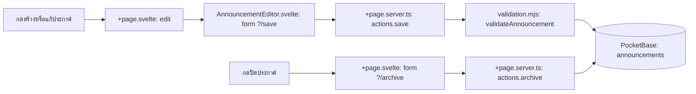

# Announcements — กดแล้วโค้ดไปไหน

| ผู้ใช้ทำอะไร | ตามไฟล์และฟังก์ชัน | ผลลัพธ์ |
| --- | --- | --- |
| กด “สร้างประกาศ” หรือแก้รายการ | [+page.svelte](src/routes/+page.svelte) `edit()` เปิด [AnnouncementEditor.svelte](src/lib/components/AnnouncementEditor.svelte) | ยังไม่บันทึก แค่เปิดฟอร์มและเติมค่ารายการเดิม |
| กดบันทึก/เผยแพร่ในฟอร์ม | `form action="?/save"` ใน [AnnouncementEditor.svelte](src/lib/components/AnnouncementEditor.svelte) → `actions.save` ใน [+page.server.ts](src/routes/+page.server.ts) → [validation.mjs](src/lib/validation.mjs) → `locals.pb.collection('announcements').create/update` | ตรวจสิทธิ์ admin และ revision; บันทึก draft หรือ published แล้วหน้าเว็บรับผลจาก form action |
| กดปิดประกาศ | [+page.svelte](src/routes/+page.svelte) ส่ง `?/archive` → `actions.archive` ใน [+page.server.ts](src/routes/+page.server.ts) | ตรวจ revision แล้วตั้ง `status: archived` ใน PocketBase |
| กดรีเฟรช | `refresh()` ใน [+page.svelte](src/routes/+page.svelte) → SvelteKit `invalidateAll()` → `load` ใน [+page.server.ts](src/routes/+page.server.ts) | ดึงรายการล่าสุดมาแสดง |

อ่าน [คู่มือระบบ](../Docs/HandOn/announcements.md) สำหรับกติกาการเผยแพร่และการเชื่อมเว็บปลายทาง
