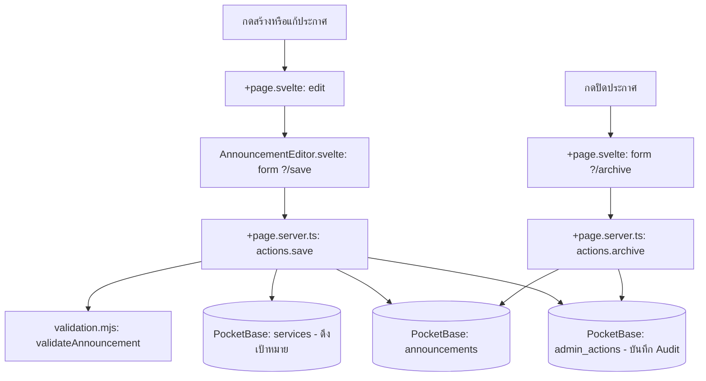

# Announcements — กดแล้วโค้ดไปไหน

| ผู้ใช้ทำอะไร | ตามไฟล์และฟังก์ชัน | ผลลัพธ์ |
| :--- | :--- | :--- |
| **กด “สร้างประกาศ” หรือแก้รายการ** | [+page.svelte](src/routes/+page.svelte) `edit()` เปิด [AnnouncementEditor.svelte](src/lib/components/AnnouncementEditor.svelte) | เปิดฟอร์มและเติมค่ารายการเดิม พร้อมโหลดปลายทางจากตาราง `services` |
| **กดบันทึก/เผยแพร่ในฟอร์ม** | `form action="?/save"` ใน [AnnouncementEditor.svelte](src/lib/components/AnnouncementEditor.svelte) → `actions.save` ใน [+page.server.ts](src/routes/+page.server.ts) → [validation.mjs](src/lib/validation.mjs) → บันทึก `announcements` | ตรวจสิทธิ์ admin, บันทึก `target_services` เชื่อมกับ `services`, และยิง Audit log ลง `admin_actions` |
| **กดปิดประกาศ** | [+page.svelte](src/routes/+page.svelte) ส่ง `?/archive` → `actions.archive` ใน [+page.server.ts](src/routes/+page.server.ts) | ตรวจ revision แล้วตั้ง `status: archived` ใน `announcements` และบันทึก Audit log ลง `admin_actions` |
| **กดรีเฟรช** | `refresh()` ใน [+page.svelte](src/routes/+page.svelte) → SvelteKit `invalidateAll()` → `load` ใน [+page.server.ts](src/routes/+page.server.ts) | ดึงรายการล่าสุดและอัปเดตสถานะ |

อ่าน [คู่มือระบบ](../Docs/HandOn/announcements.md) สำหรับกติกาการเผยแพร่และการเชื่อมเว็บปลายทาง
